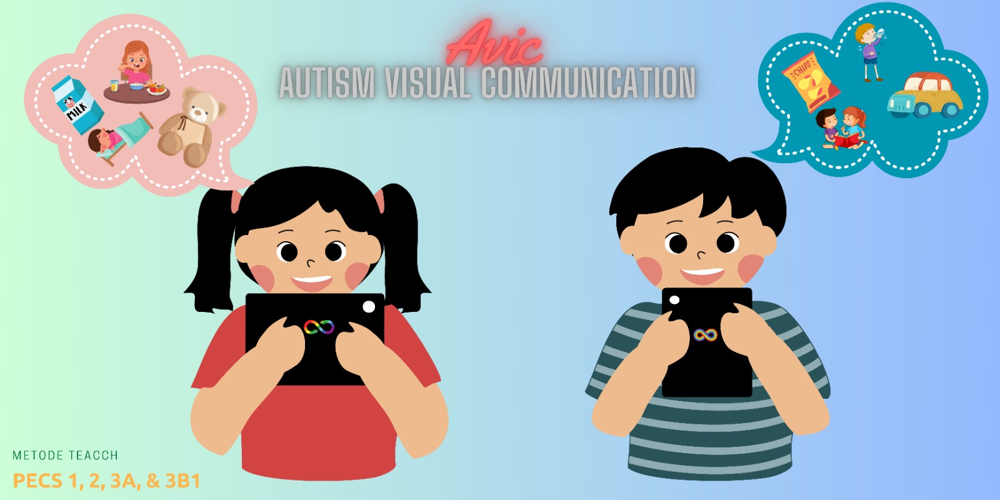

# AVIC

Autism visual communication for early student.

## Getting Started

Project ini dibangun menggunakan:
- Flutter stable `3.47.9` (atau versi stable yang lebih baru)
- Android SDK dan JDK `17`
- Minimum deployment target iOS `15.0`
- `GetX` ekosistem.
- `VelocityX` A minimalist Flutter framework for rapidly building custom designs.

---

### Documentation
- [Flutter](https://docs.flutter.dev/)
- [GetX](https://chornthorn.github.io/getx-docs/index)
- [VelocityX](https://velocityx.dev/docs/install)

### Development Guidelines :
- Design Pattern **MVC**
- Karna menggunakan `linter`, sebelum commit, pastikan check `Dart Analysis` count = 0, keep clean code sesuai anjuran flutter.
- Flow aplikasi dan wireframe ui dapat dilihat di [Andin Project - Apps Development Guidelines](https://drive.google.com/file/d/1p60wrGuoBrOqHhQlR6UVq_gjeWzZdVa2/view?usp=sharing)

---

### Sebelum mulai, mari Set-Up tools / install dibawah:

- **get_cli** : terminal : `pub global activate get_cli` atau `dart pub global activate get_cli`
- **plug-in : getXSnippet** vscode / intellij
- **dart line** : set line to 200, biar reformatting code nya tetap rapi. 

---

### PENTING!!
- untuk membuat fitur baru, terminal : `get create page:test_page`
- run `flutter packages pub run build_runner build` first!

---

### How to Run With Flavor
- Ambil dependency: `flutter pub get`
- Jalankan staging: `flutter run --flavor=staging`
- Build APK staging: `flutter build apk --flavor=staging`
- Jalankan production: `flutter run --flavor=production`
- Build APK production: `flutter build apk --flavor=production`
